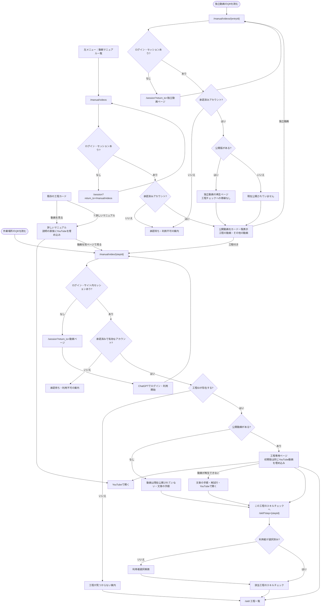
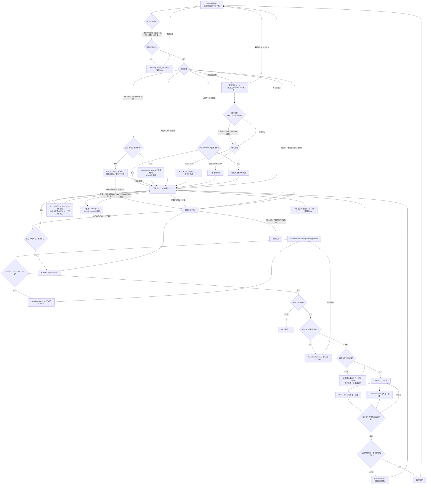
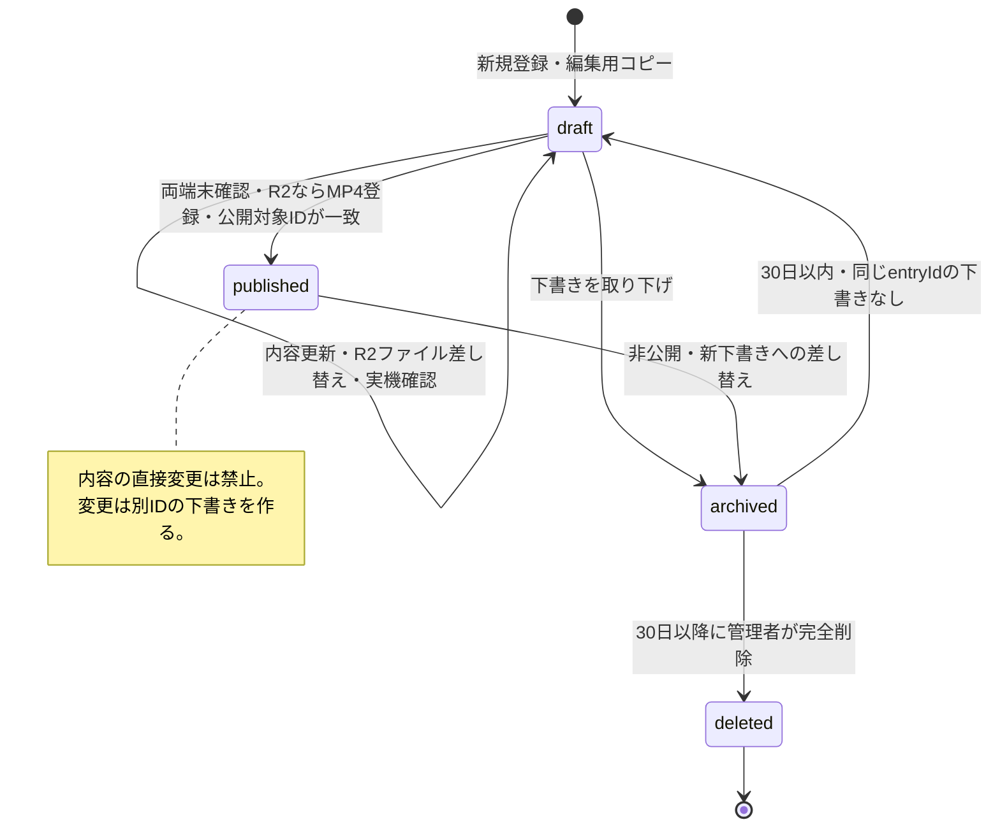
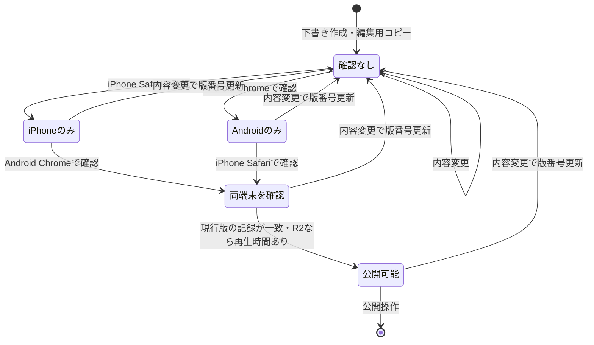

# QR動画マニュアル：画面遷移図・状態遷移図

作成日: 2026-11-17  
対象: シルクスクリーン スキルチェック Sites版  
状態: 設計案（画面・APIは未実装）  
詳細仕様: [QR動画マニュアル_画面・API設計.md](./QR動画マニュアル_画面・API設計.md)

`{stepId}` は既存マニュアルの工程ID、`{videoId}` は下書き・公開版ごとの動画レコードID、`{entryId}` は差し替え後も変わらない動画の公開用ID。**初期UIでは既存工程の「詳しいマニュアル」とQR先の専用ページに同じYouTube動画を埋め込み、左メニューから工程付き・独立動画の一覧を開ける。**工程付き動画のQRは工程URL、独立動画のQRは `entryId` の固定URLを指す。職員の下書き確認用QRは `videoId` を含む別のURLを指す。R2方式は後から追加できる保存方法として図に残す。

## 1. 利用者の画面遷移

「詳しいマニュアル」内の埋め込みとQR先の専用ページは、同じ公開動画IDを読む。工程内のプレーヤーは詳細ダイアログを開いたときだけ読み込み、閉じたら再生を止める。左メニューの一覧は工程データと別の固定リンクであり、工程付き・独立動画を同じカード形式で表示する。一般利用者には公開動画だけを表示し、職員には下書きカード・追加・編集操作も表示する。独立動画には工程チェックへの導線を表示しない。工程カード本体とスキルチェックのダイアログは現行のチェック操作を担う。「YouTubeで開く」は外部のYouTubeページへ進む。`/skill?step={stepId}` はマニュアルとアカウント情報の読込後に処理する。利用者を選ぶ必要がある場合は `pendingStep` に工程IDを保持し、選択後に該当工程を開く。仮登録者は現行画面と同じ閲覧のみの表示とする。動画を見ただけでは進捗は変わらない。

## 2. 職員の画面遷移

新規登録ではタイトルとYouTube URLだけを必須とし、工程への紐付けは任意とする。公開カードの「編集」は同じ `entryId` の同方式の下書きがあれば再利用し、なければ1件だけコピーする。公開行は直接変えない。将来のMP4差し替えはコピーしたR2下書きのファイルを更新するため、公開用の `entryId` と工程URLを維持する。YouTubeからR2へ保存方法を変える際に別方式の下書きがあれば `409` で止め、職員に既存下書きを開くか取り下げるかを示す。自動取り下げや自動再試行は行わない。取り下げ後、職員が元の公開カードから `targetSourceType=r2` の下書きを作り、ファイル更新APIを使う。MP4未登録の下書きプレビューは説明とアップロード導線だけを表示し、再生確認・公開は無効にする。保存前の新規カードの「キャンセル」はレコードを作らず、保存済み下書きの「キャンセル」は未保存入力だけを捨てて下書きを残す。下書きの取り下げは別操作で `archived` にする。職員・管理者は `/manual/videos?view=archived` の保管済みタブでカードを開き、30日以内は「下書きに復元」を押せる。カード一覧で認証・パスキー許可が切れた場合は `/manual/videos?view=drafts&edit={videoId}`、保管済みカードなら `/manual/videos?view=archived&archive={videoId}`、新規カードなら `/manual/videos?new=1`、公開カードなら `/manual/videos?focus={entryId}` に復帰する。認証後にコピー作成・復元を自動再実行しない。下書きの固定プレビューURLは職員専用で、URL自体に認証情報は含まない。端末ごとにログインとパスキー認証を行う。既存の `/passkey` は戻り先URLに未対応のため、実装時に安全なサイト内 `return_to` を受け取り、認証成功後にカードURLまたはプレビューURLへ戻す。確認後に下書きの内容を変更すると、両端末の確認は無効になる。

## 3. 動画レコードの状態遷移

この図は**1件の動画レコード**の状態を示す。公開済み動画の編集用コピーは新しいレコードとして `draft` から始まり、元の `published` レコードはそのまま残る。

同じ `entry_id` の有効な `draft` は部分ユニーク索引で1件だけにする。新下書きの公開時には、作成時の `base_published_id` と現在の公開対象IDを同じトランザクションで比較する。不一致なら `409` で下書きを維持し、旧公開版を上書きしない。一致した場合に同じ `entry_id` の旧 `published` を `archived` へ移す。工程付きの場合は同じ工程の別 `entry_id` の公開版も保管し、1工程1公開動画を守る。独立動画は他の独立動画を保管しない。切替に失敗した場合は旧動画を公開したままにする。一般向けAPIは `published` のみ返す。工程が残り、公開動画がなくなった場合は、作業場所のQRから文章の手順とスキルチェックへのリンクを表示する。独立動画の公開版がなくなった場合は固定URLで「現在公開されていません」と一覧へのリンクを表示する。完全削除では、参照されなくなったR2ファイルを確認して削除する。YouTube動画本体は削除しない。

## 4. 下書きの実機確認状態

実機確認は下書きの**内容版番号ごと**に管理する。以下の `確認なし`、`iPhoneのみ`、`Androidのみ`、`両端末` は `draft` 内の確認状態であり、動画レコードの公開状態ではない。

確認ボタンは実際に再生が始まった後に表示する。職員が一時停止・シーク・音声・任意のポスターと字幕を確認してから押す。公開APIは両端末の確認記録が現在の版番号と一致することを検査する。

## 5. 段階的なAR対応

第1段階は既存工程の「詳しいマニュアル」とQR先の専用ページの両方に同じYouTube埋め込みを表示し、動画一覧から工程付き・独立動画を開けるようにする。R2保存は必要になった時点で追加する。第2段階では動画ページから別のカメラ試作画面へ進む導線を追加する。第3段階で対象物・マーカーの認識と位置合わせを検証する。AR画面の遷移は実機試作の結果で確定し、QRの固定URLは維持する。
