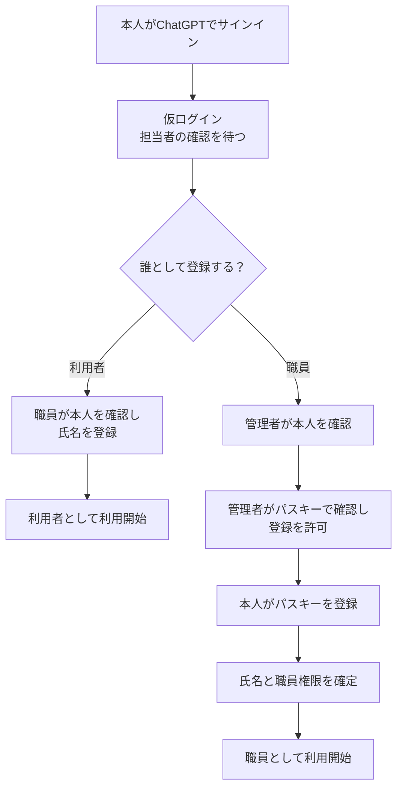

# アカウント正式登録・職員設定マニュアル

シルクスクリーン スキルチェック｜利用者・職員・管理者向け  
更新日：2026年10月22日

> 管理者は「設定」→「アカウント管理」で操作します。職員設定後、本人は「職員用パスキー登録画面」で登録します。

## まず知っておくこと

- **仮ログイン**：自分のChatGPTアカウントでサイトに入った直後の状態です。工程の文章は見られますが、写真と進捗記録は承認後に使えます。ほかの人の名前や進捗は見えません。
- **正式登録**：担当者が本人を確認し、サイトに表示する名前を氏名に直して、利用者または職員として使えるようにすることです。
- **パスキー**：端末の顔認証、指紋認証、画面ロックなどを使った本人確認です。職員設定時の二段階認証と、職員による工程・マニュアル編集の15分間の許可に使います。利用者の登録には不要です。

サイト：<https://asobe-silk-screen-skill-check.hherocl278.chatgpt.site/>

## 1. 本人が最初にすること（利用者・職員共通）

1. 自分のChatGPTアカウントでサイトに**一度サインイン**します。これが仮ログインです。
2. 画面に「管理者の承認をお待ちください」と出たら、画像上の「管理者承認後に閲覧可能」を押し、表示された管理者に連絡します。
3. 担当者と、対面または普段から使っている職場の連絡先で本人確認をします。パスワードや認証コードを伝える必要はありません。

**連絡文の例**

> スキルチェックに自分のChatGPTアカウントでサインインしました。本人確認と登録をお願いします。

「サイトに表示する氏名」は、ChatGPTアカウントの名前やメールアドレスとは別です。サイトの氏名を直しても、ChatGPTアカウントの設定は変わりません。

## 2. 利用者を登録する場合（管理者の手順）

1. 利用者本人に、対面または**以前から登録されている連絡先への折り返し**で確認します。初めて届いたメールに書かれた氏名だけでは確認を済ませません。
2. 管理者が「設定」→「アカウント管理」で「承認待ち利用者」の人を探します。表示されたメールアドレスなどを本人に確認し、別人のアカウントを選んでいないか確かめます。
3. 「区分」で**利用者**を選びます。過去の記録がある場合は本人と確認して「利用者記録」で選びます。本人に確認した**氏名を入力**し、確認チェックを入れて「保存」します。
4. 保存後、氏名と進捗が正しく表示されるか本人に確認してもらいます。違う場合は利用を止め、担当者が確認します。

**利用者への完了連絡の例**

> 登録が完了しました。サイトを開き、氏名と自分の進捗を確認してください。違う内容が表示されたら、操作を続けずに知らせてください。

利用者の登録に**パスキーや登録許可は必要ありません**。氏名と利用者としての利用開始は、一回の保存で確定します。現在、アカウント管理画面を操作できるのは管理者だけです。

## 3. 職員を設定する場合（管理者と本人の手順）

職員は工程やマニュアルを編集できるため、設定するときに追加の確認をします。

### 管理者がすること

1. 職員候補者が仮ログイン済みであることを確認します。
2. 本人に対面または以前から登録されている連絡先で確認し、管理画面の対象アカウントが本人のものか確かめます。設定する氏名も本人に確認します。
3. アカウント管理の対象者にある「職員、管理者として設定したいとき」を押します。専用画面で対象アカウント、確認した氏名、付与する権限を選びます。
4. **管理者自身のパスキーで本人確認**し、「管理者パスキーで10分間の登録許可を発行」を押します。許可はその人のアカウントだけに使え、**発行から10分以内・1回限り**です。コードをメールで送る操作はありません。
5. 職員候補者に、登録を始めてよいことを職場の連絡手段で伝えます。

**職員候補者への連絡の例**

> 本人確認が終わり、職員登録を許可しました。10分以内にご自身のアカウントでサイトを開き、ご自身の端末でパスキーを登録してください。

### 職員候補者がすること

1. 自分のChatGPTアカウントでサイトの [職員用パスキー登録画面](https://asobe-silk-screen-skill-check.hherocl278.chatgpt.site/staff-enrollment)を開き、「パスキーを登録する」を選びます。
2. 自分の端末の案内に従い、顔認証・指紋認証・画面ロックなどで登録します。端末の操作は本人が行います。
3. 登録完了後、画面に自分の氏名と「職員」が表示されることを確認します。違う場合は操作を続けず、管理者に伝えます。

職員候補者がパスキーを登録し終わるまで、職員としての操作はできません。登録が成功したときに、氏名の確定と職員権限の付与を一緒に行います。**正式登録後、工程・マニュアルを編集するときは「設定」→「編集権限」でパスキーを使って15分間の編集許可を得ます。**

## 4. 困ったとき

| 困ったこと | 対応 |
| --- | --- |
| 担当者の一覧に自分が見つからない | 正しいサイトに自分のChatGPTアカウントで一度サインインしたか確認し、担当者に一覧を更新してもらいます。 |
| 氏名がメールアドレスのまま | まだ仮ログインの可能性があります。本人確認と正式登録の完了を担当者に確認します。 |
| 別人の氏名や進捗が表示された | 記録を変更せず、すぐ担当者へ知らせます。 |
| 職員登録の許可が期限切れになった | 管理者に連絡し、本人と対象アカウントを確認したうえで、再度許可してもらいます。 |
| パスキーが登録できない | 端末の画面ロックと表示された案内を確認します。解決しない場合は、画面に出た日本語のメッセージを管理者に伝えます。 |
| 端末を紛失した・心当たりのない登録がある | すぐ管理者へ知らせます。管理者は職員権限と登録済みパスキーの停止手続きを進めます。 |

## 5. 担当者の確認表

- [ ] 本人を対面または以前から登録された連絡先で確認した
- [ ] 管理画面のアカウントが本人のものと確認した
- [ ] 本人に氏名を確認し、サイト内の表示名を正しく設定した
- [ ] 利用者なら、本人の進捗と利用者権限を保持して登録した
- [ ] 職員なら、管理者のパスキー確認と本人のパスキー登録を終えてから職員権限を有効にした
- [ ] 本人に表示内容と利用開始を確認してもらった
